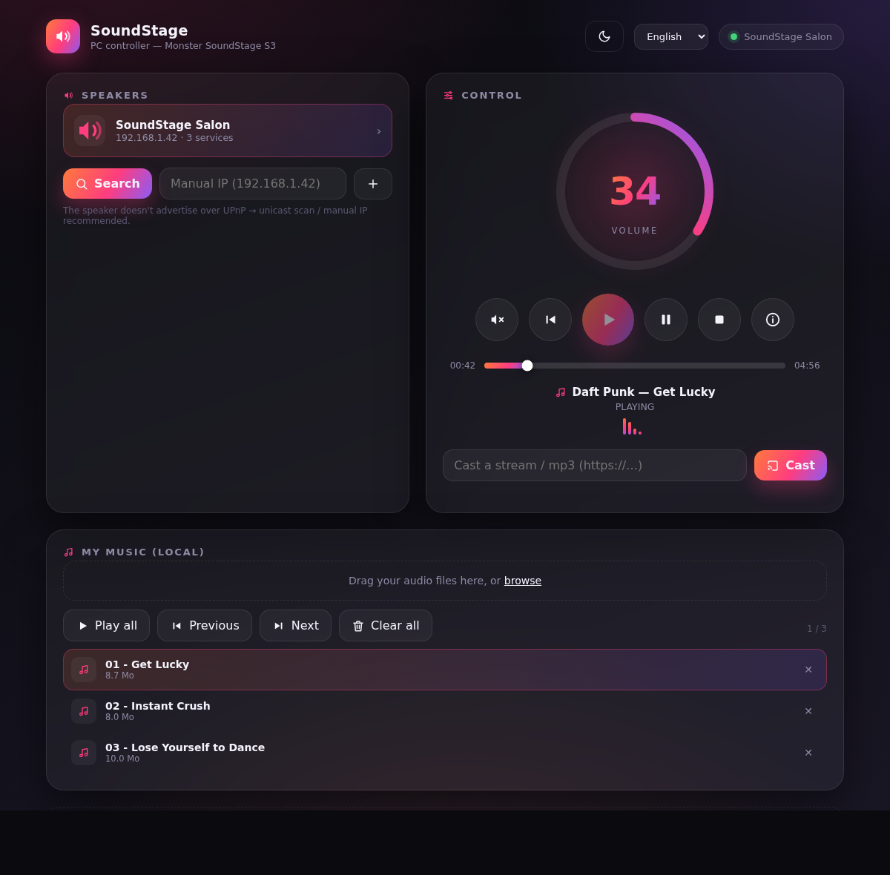

<div align="center">

# 🔊 SoundStage PC

**Control your Monster SoundStage S3 (Qualcomm AllPlay) speaker from any PC — zero dependencies.**

A tiny local server + a slick web UI. Volume, playback and stream casting, straight from your browser. Windows 11 · macOS · Linux.

[](LICENSE)
[](https://nodejs.org)
[](#)



</div>

---

🇫🇷 **[Français](#-français)** · 🇬🇧 **[English](#-english)** · 🧩 **[Architecture](docs/ARCHITECTURE.md)** · 🔬 **[Protocol notes](docs/PROTOCOL.md)**

---

## 🇫🇷 Français

### C'est quoi ?

Une application pour **piloter une enceinte Monster SoundStage S3** (puce Qualcomm AllPlay) depuis un ordinateur. L'appli officielle d'origine n'est plus maintenue et ne tourne plus sur les Android récents — ce projet la remplace côté PC.

**Fonctionnalités**
- 🔊 **Volume** (bouton circulaire, glisser) + **mute**
- ▶⏸⏹ **Lecture / pause / stop** (et piste précédente)
- 📡 **Caster un flux** : envoie une URL audio (mp3, radio HTTP) directement sur l'enceinte
- 🔎 Découverte réseau (SSDP + scan unicast) ou **IP manuelle**
- 🧪 Outils **Avancé** : diagnostic réseau, probe, describe UPnP, détection de pages

### Pourquoi un « petit serveur local » ?

Un navigateur **ne peut pas** envoyer du SSDP (pas de multicast UDP en JavaScript) ni parler SOAP vers l'enceinte (pas de CORS). Il faut donc un minuscule serveur local (Node, **zéro dépendance**) qui fait le réseau… et sert l'interface web dans ton navigateur.

### Démarrage rapide

1. Installe **Node.js** (≥ 18) : <https://nodejs.org>
2. Lance :
   - **Windows** : double-clique **`start.bat`**
   - **macOS / Linux** : `./start.sh` (ou `node server.js`)
3. Ouvre **<http://localhost:8099>**
4. Clique **Rechercher**, ou saisis l'**IP** de l'enceinte puis **+**

> 💡 Astuce : `http://localhost:8099/#demo` affiche l'interface remplie, sans enceinte (démo).

### Prérequis

- PC et enceinte sur le **même réseau**.
- Que l'enceinte expose son renderer **DLNA/UPnP** (voir ci-dessous).
- Pas de port à ouvrir : le serveur n'écoute qu'en **local**.

### Comment ça marche (résumé)

L'enceinte S3 expose plusieurs services réseau (voir **[docs/PROTOCOL.md](docs/PROTOCOL.md)** pour tout le détail) :

| Port | Service | Usage |
|------|---------|-------|
| **2870** | **Renderer DLNA/UPnP** (`MediaRenderer:1`) | ✅ volume, mute, transport, cast — *c'est ce qu'on pilote* |
| 8080 | Spotify Connect (`zeroConf`) | lecture Spotify |
| 9955 | Bus AllJoyn (AllPlay) | multiroom, sélection d'entrée, playlist |
| 80 | Admin web (OpenWRT/LuCI) | config de l'enceinte |
| 8086 / 8087 | services internes | — |

Notre appli parle **DLNA/UPnP (SOAP)** au renderer du **port 2870**. Comme l'enceinte **ne répond pas au SSDP multicast**, on la trouve par **scan unicast** ou par **IP manuelle**.

---

## 🇬🇧 English

### What is it?

An app to **control a Monster SoundStage S3 speaker** (Qualcomm AllPlay module) from a computer. The original vendor app is unmaintained and no longer runs on recent Android versions — this project replaces it on the PC side.

**Features**
- 🔊 **Volume** (circular knob, drag) + **mute**
- ▶⏸⏹ **Play / pause / stop** (and previous track)
- 📡 **Cast a stream**: push an audio URL (mp3, HTTP radio) straight to the speaker
- 🔎 Network discovery (SSDP + unicast scan) or **manual IP**
- 🧪 **Advanced** tools: network diagnostics, probe, UPnP describe, page discovery

### Why a “local server”?

A browser **cannot** send SSDP (no UDP multicast in JavaScript) nor talk SOAP to the speaker (no CORS). So we run a tiny local Node server (**zero dependencies**) that does the networking and serves the web UI into your browser.

### Quick start

1. Install **Node.js** (≥ 18): <https://nodejs.org>
2. Run:
   - **Windows**: double-click **`start.bat`**
   - **macOS / Linux**: `./start.sh` (or `node server.js`)
3. Open **<http://localhost:8099>**
4. Click **Search**, or type the speaker **IP** then **+**

> 💡 Tip: `http://localhost:8099/#demo` shows the UI filled with demo data, no speaker needed.

### Requirements

- PC and speaker on the **same network**.
- The speaker must expose its **DLNA/UPnP renderer** (see below).
- No ports to open: the server only listens **locally**.

### How it works (short version)

The S3 exposes several network services (full details in **[docs/PROTOCOL.md](docs/PROTOCOL.md)**):

| Port | Service | Use |
|------|---------|-----|
| **2870** | **DLNA/UPnP renderer** (`MediaRenderer:1`) | ✅ volume, mute, transport, cast — *what we drive* |
| 8080 | Spotify Connect (`zeroConf`) | Spotify playback |
| 9955 | AllJoyn bus (AllPlay) | multi-room, input selection, playlist |
| 80 | Web admin (OpenWRT/LuCI) | speaker configuration |
| 8086 / 8087 | internal services | — |

Our app speaks **DLNA/UPnP (SOAP)** to the renderer on **port 2870**. Since the speaker **doesn't answer multicast SSDP**, we find it via a **unicast scan** or a **manual IP**.

---

## 🧩 Project layout

```
MonsterSoundStage-PC/
├── server.js              # zero-dependency Node server (discovery + DLNA/SOAP + static UI)
├── public/index.html      # the entire web UI (single file, inline SVG icons)
├── start.bat / start.sh   # one-click launchers
├── package.json
└── docs/
    ├── PROTOCOL.md        # reverse-engineering notes (all ports, DLNA, Spotify, AllJoyn…)
    ├── ARCHITECTURE.md    # how the app is built
    └── screenshots/
```

## 🛠️ Build a standalone `.exe` (optional)

```bash
npm i -g @yao-pkg/pkg
pkg . --targets node20-win-x64 --output SoundStagePC.exe
```

## ⚠️ Disclaimer

Unofficial project, **not affiliated** with Monster Products or Qualcomm. Provided “as is”, no warranty. Only use it on hardware you own.

## 📄 License

**[The Unlicense](LICENSE)** — public domain. Do **whatever you want**, no conditions, no attribution required.

## 🙏 Credits

- Digital Media Renderer control: UPnP/DLNA (`AVTransport`, `RenderingControl`).
- Background research on the AllPlay protocol ecosystem: the [tchaikovsky](https://github.com/dominicdesu/tchaikovsky) library, the openHAB AllPlay binding, and [allplay-preset-tool](https://github.com/IntWildfred/allplay-preset-tool).
